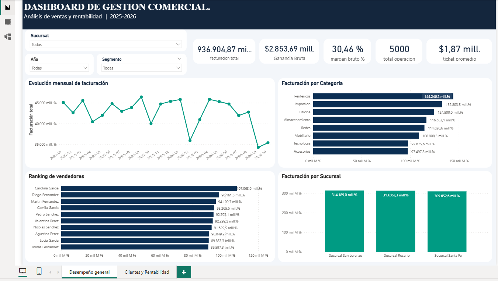
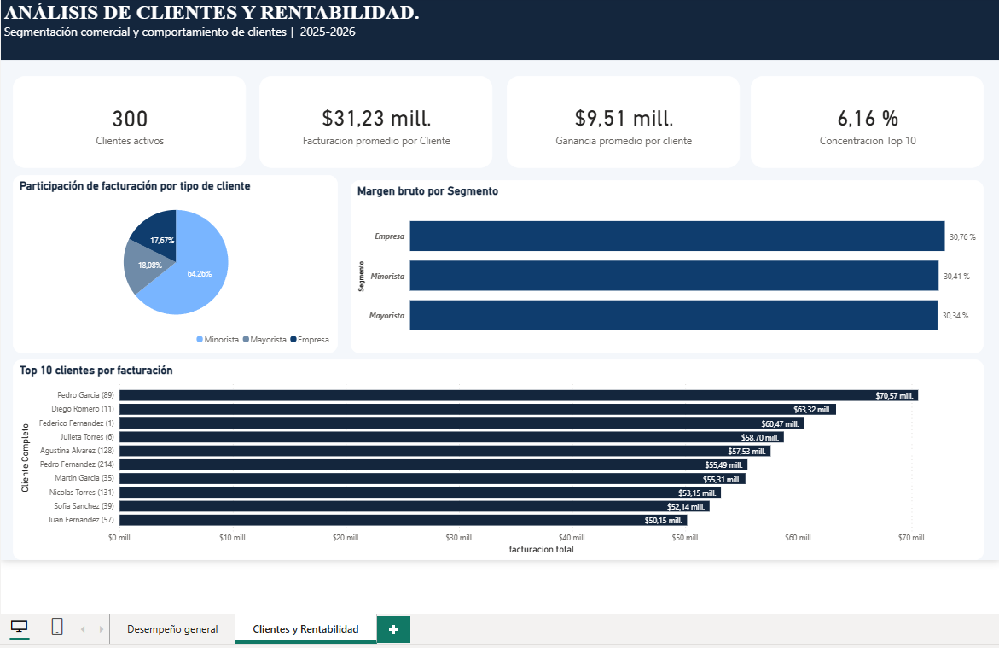

# 📊 Análisis de Ventas y Rentabilidad | SQL Server + Power BI

## Descripción del proyecto

Este proyecto forma parte de mi portfolio profesional de análisis de datos. Su objetivo es analizar el desempeño comercial de una empresa mediante la construcción de una base de datos relacional en SQL Server y el desarrollo de un dashboard interactivo en Power BI.

El análisis permite identificar tendencias de ventas, evaluar la rentabilidad y obtener información útil para la toma de decisiones comerciales.

**Nota:** se utilizaron datos simulados con fines educativos y de portfolio.

## Herramientas utilizadas

- **SQL Server:** almacenamiento, consultas y análisis de datos.
- **SQL Server Management Studio (SSMS):** gestión de la base de datos.
- **Power BI Desktop:** visualización y creación de dashboards.
- **DAX:** desarrollo de medidas e indicadores de gestión.
- **Power Query:** importación y preparación de datos.

## Estructura de la base de datos

Se trabajó con seis tablas relacionadas:

- Clientes
- Productos
- Vendedores
- Sucursales
- Ventas
- Detalle_Ventas

El conjunto de datos incluye:

- 300 clientes.
- 80 productos.
- 10 vendedores.
- 3 sucursales.
- 5.000 operaciones de venta.
- 9.645 registros de detalle.

Período analizado: enero de 2025 a octubre de 2026.

## Indicadores principales

| Indicador | Resultado |
|---|---|
| Facturación total | $9.369,05 millones |
| Ganancia bruta | $2.853,69 millones |
| Margen bruto | 30,46% |
| Operaciones | 5.000 |
| Clientes activos | 300 |
| Ticket promedio | $1,87 millones |

## Dashboard de Power BI

### Página 1 — Desempeño general

Incluye indicadores de facturación, rentabilidad y operaciones, evolución mensual de ventas, comparación entre sucursales y categorías de productos, y ranking de vendedores.

### Página 2 — Clientes y rentabilidad

Incluye análisis de clientes activos, facturación y ganancia promedio por cliente, participación de ingresos por segmento, márgenes comerciales, ranking de clientes y concentración de facturación.

## Principales hallazgos

**1. Participación comercial:** el segmento Minorista representa el 64,26% de la facturación total.

**2. Rentabilidad:** el segmento Empresa registra el mayor margen bruto porcentual, con 30,76%.

**3. Concentración de clientes:** los diez principales clientes representan aproximadamente el 6,16% de la facturación, lo que muestra una distribución relativamente amplia de los ingresos.

**4. Desempeño de sucursales:** San Lorenzo presenta la mayor facturación acumulada, seguida de Rosario y Santa Fe.

## Competencias aplicadas

- Modelado y consulta de bases de datos relacionales.
- Consultas SQL con JOIN, GROUP BY y funciones de agregación.
- Limpieza y validación de datos.
- Creación de medidas DAX.
- Diseño de indicadores KPI.
- Visualización de datos e interpretación de resultados.
- Análisis comercial orientado a la toma de decisiones.

## Objetivo profesional

Continuar desarrollando habilidades en análisis de datos, inteligencia de negocios y gestión empresarial, aplicándolas a áreas de administración, operaciones, gestión comercial y servicios financieros.

---

**Autor:** Franco Secchi  
**Proyecto:** Portfolio de Análisis de Datos — Ventas y Rentabilidad
